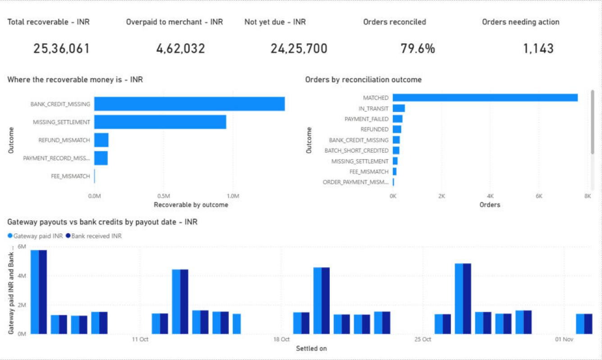
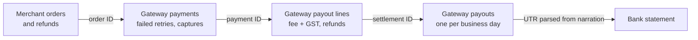
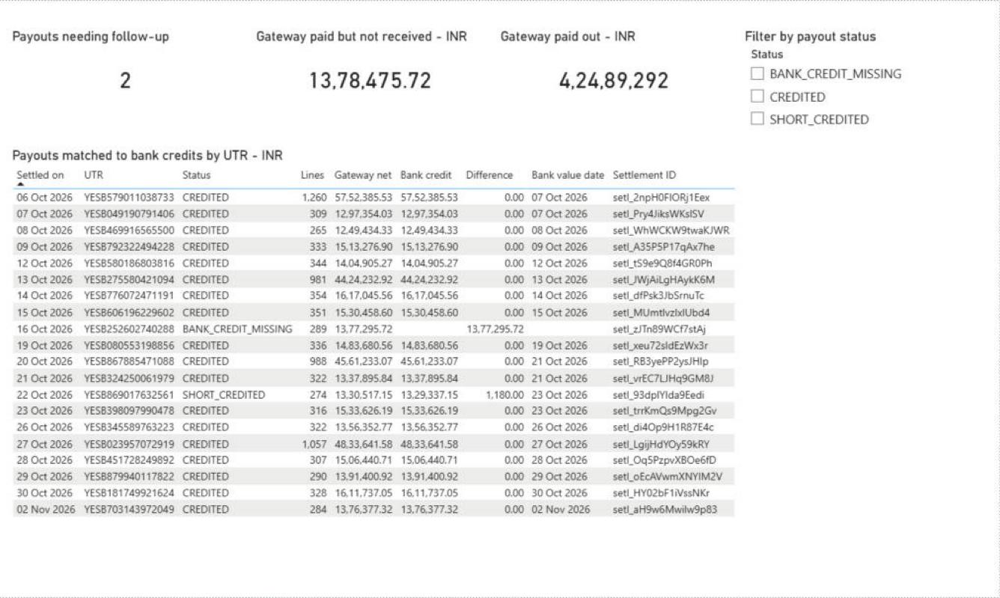
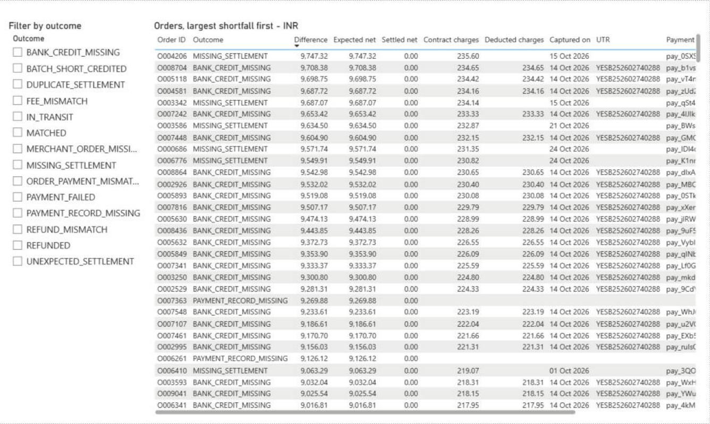

<picture><source media="(prefers-color-scheme: light)" srcset="docs/images/banner-light.svg"></picture>

# Merchant Settlement Reconciliation

**Three-way payment reconciliation for an Indian online merchant: merchant books → payment gateway → bank statement.**


An online merchant sells through a payment gateway. Every day the gateway captures payments, deducts its fee plus 18% GST, nets off refunds and pays the balance out in a T+2 batch. The finance team then has to answer one question:

> **Did every rupee we sold actually reach our bank account, and if not, where did it go?**

This project answers that for a synthetic month of 10,000 orders (October 2026). It matches the merchant's books against the gateway's reports and the bank statement, then sorts every gap into an exception someone can act on.



---

## Contents

- [Headline results](#headline-results)
- [Why this is hard](#why-this-is-hard)
- [How it works](#how-it-works)
- [Exception rules](#exception-rules)
- [How the results were checked](#how-the-results-were-checked)
- [Power BI report](#power-bi-report)
- [Run it](#run-it)
- [Project structure](#project-structure)
- [Limitations](#limitations)

---

## Headline results

Reconciled as of 2 November 2026.

| | Orders | Amount (INR) |
|---|---:|---:|
| **Recoverable from gateway or bank** | **699 + 1 payout** | **25,36,060.65** |
| ↳ Payout the gateway sent on 16 Oct that never reached the bank | 289 | 13,77,295.72 |
| ↳ Captured payments overdue for settlement | 200 | 9,53,767.32 |
| ↳ Partial refunds the gateway processed in full | 40 | 1,02,890.94 |
| ↳ Orders marked paid with no gateway record | 20 | 96,721.67 |
| ↳ Payments charged on the wrong pricing plan (2.5% vs 2%) | 150 | 4,205.00 |
| ↳ Charges the bank deducted from the 22 Oct payout | 1 payout | 1,180.00 |
| **Overpaid to the merchant** (duplicate payouts, failed payments settled) | 90 | 4,62,031.50 |
| **Not yet due** (captured within the last T+2 window) | 500 | 24,25,700.46 |
| Matched, including 350 correctly netted refunds | 7,957 | — |

The remaining 754 orders are:

- 400 failed payments, where nothing was captured and nothing is owed.
- 274 orders inside the short-credited payout.
- 80 orders where the merchant and gateway records disagree but no money is missing.

25 bank credits had no gateway UTR (customer NEFTs, UPI receipts, interest). They are listed separately rather than forced into a match. The full breakdown is in [`data/processed/summary.json`](data/processed/summary.json).

**The finding a finance team would act on first:** more than half of the recoverable amount is one gateway payout. The gateway reports it as paid, but the bank never received it. Checking order by order would never find it. It only shows up when payouts are matched to bank credits by UTR, which is why the reconciliation runs at both the order level and the payout level.

---

## Why this is hard

The three sources share no common key:

| Source | What it knows | Example |
|---|---|---|
| Merchant books | Order IDs, order amounts, refunds | `O004206`, ₹9,747.32 |
| Payment gateway | Payment IDs, failed retries, payout lines with fee + GST, payout batches | `pay_0SXS…`, `setl_2npH0FIORj1Eex` |
| Bank statement | Value date and free-text narration with a UTR in it | `RTGS-YESB427976271653-PAYGATE INDIA PVT LTD-SETL`, `"87,535.86"` |

Bank amounts use Indian digit grouping (`13,92,589.56`). The UTR has to be pulled out of messy narration. Interest and customer transfers sit on the same statement, and a payout may reach the bank a business day late.

---

## How it works



1. **Order ↔ payment.** Each merchant order is matched to its gateway payments. A failed UPI attempt followed by a successful retry still matches. Two captured payments are flagged as a double charge.
2. **Payment ↔ payout line.** Each capture is found in a payout line. The deducted fee + GST is checked against the contract (2% fee, 18% GST, each rounded half-up). Refunds are netted.
3. **Payout ↔ bank credit.** The UTR is extracted from each bank narration and matched to the gateway payout. Payouts are due T+2 business days after capture, with one business day allowed for bank credit lag. Weekends and bank holidays (Gandhi Jayanti, 2 October) are skipped.
4. **Classify.** Every order keeps all the flags that apply (`exception_flags`). Its primary `status` is the most serious one.

All arithmetic is in integer paise, so there are no floating-point rounding errors.

---

## Exception rules

| Status | Rule | Difference reported |
|---|---|---|
| `BANK_CREDIT_MISSING` | Payout's UTR not on the bank statement one business day after payout | Order's full net |
| `MISSING_SETTLEMENT` | Captured, past T+2 business days, in no payout | Full net |
| `REFUND_MISMATCH` | Gateway refund deductions ≠ merchant's refund records | Excess deducted |
| `PAYMENT_RECORD_MISSING` | Merchant shows the order paid; gateway has no payment | Expected net |
| `FEE_MISMATCH` | Deducted fee + GST ≠ contract | Overcharge |
| `BATCH_SHORT_CREDITED` | Bank credited less than the payout total | Reported at payout level, since it can't be assigned to one order |
| `DUPLICATE_SETTLEMENT` | Same payment in two payout lines | Negative (overpaid) |
| `UNEXPECTED_SETTLEMENT` | Failed payment was paid out | Negative (overpaid) |
| `DOUBLE_CHARGED` | Two captured payments for one order (customer owed a refund) | — |
| `ORDER_PAYMENT_MISMATCH`, `MERCHANT_ORDER_MISSING` | Merchant and gateway disagree on amount or existence | — |
| `PAYMENT_FAILED` | No successful capture; nothing is owed | — |
| `IN_TRANSIT` | Not yet due under T+2, or payout sent but bank credit not yet due | Blank, nothing is owed yet |
| `REFUNDED`, `MATCHED` | Everything agrees | 0 |

---

## How the results were checked

A reconciler checked only against data its own author generated proves little, because the two can share the same mistakes. So there are three layers of checks:

1. **Hand-calculated rule tests** ([`tests/test_rules.py`](tests/test_rules.py)). 28 small cases worked out by hand, independent of the generator. They cover fee and GST rounding, T+2 across a holiday weekend, UTR extraction from messy narration, each exception type, and the exact point where `IN_TRANSIT` becomes overdue.
2. **Tampering tests** ([`tests/test_pipeline.py`](tests/test_pipeline.py)). These delete a bank credit or a gateway payout line from generated data and confirm the reconciler detects the damage without using any labels.
3. **Full ground-truth comparison** ([`verify_reconciliation.py`](verify_reconciliation.py)). The generator records each problem it injects, and the reconciler never reads that file. The verifier checks all 10,000 orders and 20 payouts for exact status and amount.

```text
$ python -m pytest -q
33 passed

$ python verify_reconciliation.py
ALL CHECKS PASSED: 10,000 orders and 20 payout batches match ground truth (status and amount, to the paisa).
```

The verifier caught two real bugs during development: a payout batch that went negative when early refunds had nothing to net against, and a number formatter that mishandled negative amounts.

---

## Power BI report

**[Download the populated report (`Settlement_Review_Updated.pbix`)](powerbi/Settlement_Review_Updated.pbix)** and open it in Power BI Desktop. It works offline and has three pages.

### 1. Overview

KPIs for total recoverable, overpaid, not yet due, share of orders reconciled, and orders needing action (1,143). The charts show where the recoverable money sits, orders by outcome, and gateway payouts against bank credits for each payout date. The missing 16 October payout shows up as a gap in the bank bars. *(Screenshot at the top of this page.)*

### 2. Payouts

Each of the 20 gateway payouts matched to its bank credit by UTR, filterable by status. Two need follow-up: 16 Oct was never credited (₹13,77,295.72), and 22 Oct was short-credited by ₹1,180.00.



### 3. Order investigation

The full order ledger, filterable by outcome and sorted largest shortfall first. Each row shows the contract fee against the fee actually deducted, the UTR and the payment ID, so an analyst can raise a dispute straight from it.



### Rebuilding the report from source

The report is also stored as a Power BI project (PBIP), so its model and visuals are readable JSON under version control:

- Semantic model: [`powerbi/Settlement_Review.SemanticModel/model.bim`](powerbi/Settlement_Review.SemanticModel/model.bim). It has the `Ledger` and `Payouts` tables and their DAX measures.
- Report pages: [`powerbi/Settlement_Review.Report/definition/pages/`](powerbi/Settlement_Review.Report/definition/pages/).

To rebuild it:

1. Open [`powerbi/Settlement_Review.pbip`](powerbi/Settlement_Review.pbip).
2. Set **Transform data → Edit parameters → DataFolder** to this repository's `data/processed` folder.
3. Select **Refresh**.

---

## Run it

Python 3.10+. The pipeline uses only the standard library; pytest is the only dependency.

```bash
python -m pip install -r requirements.txt   # pytest only
python generate_large_data.py               # seeded month -> data/generated/
python reconcile.py                         # -> data/processed/ (report, payouts, unmatched bank lines, summary)
python verify_reconciliation.py             # compare against the injected ground truth
python build_database.py                    # SQLite tables + review queue
python -m pytest -q
```

`python reconcile.py --as-of 2026-10-20` re-runs the reconciliation as of an earlier date. Payments captured after that date then show as `IN_TRANSIT` instead of overdue.

A 200-order sample in the same format is committed in [`data/sample/`](data/sample/), so you can read the input files without running anything.

### Outputs

| File (in `data/processed/`) | Contents |
|---|---|
| `reconciliation_report.csv` | One row per order: status, all flags, expected vs received, payment ID, payout, UTR, fees and refunds |
| `settlement_batches.csv` | One row per gateway payout: gateway total vs bank credit, matched by UTR |
| `unmatched_bank_lines.csv` | Bank credits that are not gateway payouts, with the reason |
| `summary.json` | The headline totals above |
| `reconciliation.db` | SQLite tables `reconciliation_results` and `settlement_batches` (amounts in paise); created locally, not committed |

---

## Project structure

```text
merchant-settlement-reconciliation/
├── reconcile.py               # three-way matching engine and exception rules
├── generate_large_data.py     # seeded 10,000-order month with injected problems + ground truth
├── verify_reconciliation.py   # checks every order and payout against ground truth
├── build_database.py          # loads outputs into SQLite and prints the review queue
├── tests/
│   ├── test_rules.py          # hand-calculated rule cases
│   └── test_pipeline.py       # tampering tests on generated data
├── data/
│   ├── sample/                # 200-order sample of every input file
│   └── processed/             # reconciliation outputs used by Power BI
├── powerbi/
│   ├── Settlement_Review_Updated.pbix        # populated report
│   ├── Settlement_Review.pbip                # project file
│   ├── Settlement_Review.SemanticModel/      # model.bim (tables, DAX measures)
│   └── Settlement_Review.Report/             # page and visual definitions
└── docs/images/               # report screenshots
```

---

## Limitations

- The data is synthetic. Formats follow common Indian gateway and bank conventions but do not copy any specific provider's file layout.
- One payment per payout line and one payout per business day. Real gateways also have chargebacks, split settlements for marketplaces and reserve holds, which are not modelled.
- The fee contract is a flat 2% for every payment method. In reality UPI, cards and net banking are priced differently.
- The holiday calendar covers October 2026 national holidays only. State-specific bank holidays would need adding.
- A short-credited payout's loss is not allocated to individual orders.

## Author

Built by [Amaan Shaikh](https://amaanshaikh.dev), fintech data analyst. More projects and résumé at [amaanshaikh.dev](https://amaanshaikh.dev).
