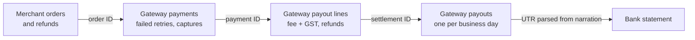

# Merchant Settlement Reconciliation

### Three-way payment reconciliation | Python · SQL · Power BI

An online merchant in India sells through a payment gateway. Every day the gateway captures payments, deducts its fee plus 18% GST, nets off refunds and pays out the balance in a T+2 batch. The merchant's finance team then has to answer: **did every rupee we sold actually reach our bank account, and if not, where did it go?**

This project answers that question for a synthetic month of 10,000 orders. It matches the merchant's own books against the gateway's reports and the bank statement, then sorts every gap into an actionable exception.


The hard part is that the three sources share no common key. The merchant has order IDs. The gateway has payment IDs, refund IDs and payout batches. The bank statement only has a UTR buried in free-text narration such as `rtgs cr yesb168633123744 paygate settlement`, with amounts written in Indian digit grouping (`13,92,589.56`).



## Results for October 2026 (reconciled on 2 November)

| | Orders | Amount (INR) |
|---|---:|---:|
| **Recoverable from gateway or bank** | **699 + 1 payout** | **25,36,060.65** |
| Payout the gateway sent on 16 Oct that never reached the bank | 289 | 13,77,295.72 |
| Captured payments overdue for settlement | 200 | 9,53,767.32 |
| Partial refunds the gateway processed in full | 40 | 1,02,890.94 |
| Orders marked paid with no gateway record | 20 | 96,721.67 |
| Payments charged on the wrong pricing plan (2.5% vs 2%) | 150 | 4,205.00 |
| Charges the bank deducted from the 22 Oct payout | 1 payout | 1,180.00 |
| **Overpaid to the merchant** (duplicate payouts, failed payments settled) | 90 | 4,62,031.50 |
| **Not yet due** (captured within the last T+2 window) | 500 | 24,25,700.46 |
| Matched, including 350 correctly netted refunds | 7,957 | — |

The remaining 754 orders are failed payments (400), orders inside the short-credited payout (274), and orders where the merchant and gateway records disagree with no money gap (80). 25 bank credits had no gateway UTR (customer NEFTs, UPI receipts, interest), and they were listed separately rather than forced into a match. The full breakdown is in [`data/processed/summary.json`](data/processed/summary.json).

**The finding a finance team would act on first:** more than half the recoverable amount is a single gateway payout that the gateway reports as paid but the bank never received. Checking order by order would not find it. It shows up only by matching payouts to bank credits by UTR, which is why the reconciliation runs at both the order level and the payout level.

## Exception rules

| Status | Rule | Difference reported |
|---|---|---|
| `BANK_CREDIT_MISSING` | Payout's UTR not on the bank statement one business day after payout | Order's full net |
| `MISSING_SETTLEMENT` | Captured, past T+2 business days, in no payout | Full net |
| `REFUND_MISMATCH` | Gateway refund deductions ≠ merchant's refund records | Excess deducted |
| `PAYMENT_RECORD_MISSING` | Merchant shows the order paid; gateway has no payment | Expected net |
| `FEE_MISMATCH` | Deducted fee + GST ≠ contract (2% fee, 18% GST, each rounded half-up) | Overcharge |
| `BATCH_SHORT_CREDITED` | Bank credited less than the payout total | Reported at payout level, since it can't be assigned to one order |
| `DUPLICATE_SETTLEMENT` | Same payment in two payout lines | Negative (overpaid) |
| `UNEXPECTED_SETTLEMENT` | Failed payment was paid out | Negative (overpaid) |
| `DOUBLE_CHARGED` | Two captured payments for one order (customer owed a refund) | — |
| `ORDER_PAYMENT_MISMATCH`, `MERCHANT_ORDER_MISSING` | Merchant and gateway disagree on amount or existence | — |
| `IN_TRANSIT` | Not yet due under T+2, or payout sent but bank credit not yet due | Blank, nothing is owed yet |
| `REFUNDED`, `MATCHED` | Everything agrees | 0 |

An order keeps every flag that applies (`exception_flags`). Its primary `status` is the most serious one. Business days skip weekends and bank holidays (Gandhi Jayanti, 2 October, is in the calendar). Failed UPI attempts followed by a successful retry are matched correctly, and gateway receipts with stray case or spaces are normalised. All arithmetic uses integer paise.

## How the results were checked

A reconciler checked only against data its author generated proves little, because the two can share the same mistakes. So there are three layers of checks:

1. **Hand-calculated rule tests** ([`tests/test_rules.py`](tests/test_rules.py)). These are 28 small cases worked out by hand, independent of the generator: fee and GST rounding, T+2 across a holiday weekend, UTR extraction from messy narration, each exception type, and the boundary where `IN_TRANSIT` becomes overdue.
2. **Tampering tests** ([`tests/test_pipeline.py`](tests/test_pipeline.py)). These delete a bank credit or a gateway payout line from generated data and confirm the reconciler detects the damage without using any labels.
3. **Full ground-truth comparison** ([`verify_reconciliation.py`](verify_reconciliation.py)). The generator records each problem it injects. The reconciler never reads that file. The verifier checks all 10,000 orders and 20 payouts for exact status and amount.

Building the verifier caught two real bugs during development: a payout batch that went negative when early refunds had nothing to net against, and a number formatter that mishandled negative amounts.

```
33 passed
ALL CHECKS PASSED: 10,000 orders and 20 payout batches match ground truth (status and amount, to the paisa).
```

## Run it

Python 3.10+; the pipeline uses only the standard library.

```bash
python -m pip install -r requirements.txt   # pytest only
python generate_large_data.py               # seeded month -> data/generated/
python reconcile.py                         # -> data/processed/ (report, payouts, unmatched bank lines, summary)
python verify_reconciliation.py             # compare against injected ground truth
python build_database.py                    # SQLite tables + review queue
python -m pytest -q
```

`reconcile.py --as-of 2026-10-20` re-runs the reconciliation as of an earlier date. Payments captured after that date then show as `IN_TRANSIT` instead of overdue. A 200-order sample in the same format is committed in [`data/sample/`](data/sample/) so the input files can be read without running anything.

## Outputs

| File | Contents |
|---|---|
| `reconciliation_report.csv` | One row per order: status, all flags, expected vs received, payment ID, payout, UTR, fees and refunds |
| `settlement_batches.csv` | One row per gateway payout: gateway total vs bank credit, matched by UTR |
| `unmatched_bank_lines.csv` | Bank credits that are not gateway payouts, with the reason |
| `summary.json` | Headline totals shown above |
| `reconciliation.db` | SQLite: `reconciliation_results`, `settlement_batches` (amounts in paise) |

## Power BI

**[Download the populated report](powerbi/Settlement_Review_Updated.pbix)** and open it in Power BI Desktop; it works offline. It has three pages:

- **Overview.** KPIs for total recoverable, overpaid, not yet due, share reconciled and orders needing action. Charts show where the recoverable money sits by outcome, orders by outcome, and gateway payouts against bank credits for each payout date. The missing 16 October payout shows up as a gap.
- **Payouts.** Each gateway payout matched to its bank credit by UTR, filterable by status.
- **Order investigation.** The full order ledger, filterable by outcome and sorted largest shortfall first, with fees deducted against the contract, the UTR and the payment ID.


To rebuild it from source, open [`powerbi/Settlement_Review.pbip`](powerbi/Settlement_Review.pbip), set **Transform data → Edit parameters → DataFolder** to this repository's `data/processed` folder, and select **Refresh**.

## Limitations

- The data is synthetic. Formats follow common Indian gateway and bank conventions but do not copy any specific provider's file layout.
- One payment per payout line and one payout per business day. Real gateways also have chargebacks, split settlements for marketplaces, and reserve holds, which are not modelled.
- The fee contract is a flat 2% for every method. In reality UPI, cards and net banking are priced differently.
- The holiday calendar covers October 2026 national holidays only. State-specific bank holidays would need adding.
- A short-credited payout's loss is not allocated to individual orders.
